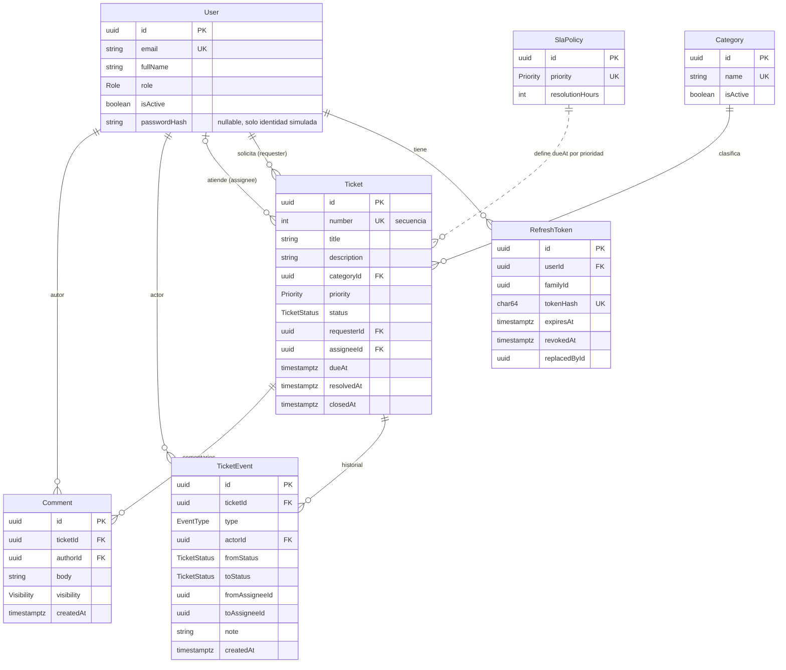
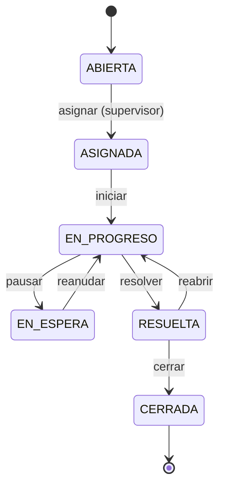

# SIGA-TI — Modelo de datos (Etapa 1)

Esquema Prisma propuesto: [`schema.prisma`](./schema.prisma). Identificadores de código en inglés; valores de enums del dominio en español (lenguaje ubicuo del enunciado).

## 1. Diagrama entidad–relación



## 2. Entidades y decisiones por tabla

| Tabla | Decisiones |
|---|---|
| `users` | `email` único, normalizado a minúsculas **en el dominio** antes de persistir. Rol único por usuario (supuesto S-3). `isActive` en lugar de borrado. `passwordHash` nullable (ADR-009). |
| `refresh_tokens` | Solo hash SHA-256 (`CHAR(64)`, único). `familyId` agrupa la cadena de rotación; `replacedById` enlaza el sucesor; `revokedAt` marca revocación. Limpieza de expirados: tarea de mantenimiento fuera del prototipo (se documenta). |
| `categories` | Nombre único; `isActive` (no se borran: los tickets las referencian, `onDelete: Restrict`). |
| `sla_policies` | Una fila por prioridad (`priority` único). Cambiarla **no** recalcula tickets existentes (`dueAt` es instantánea). |
| `tickets` | `number` autoincremental → `SIGA-` + 6 dígitos con relleno (`SIGA-000123`). Sin borrado (no hay endpoint, FK `Restrict`). `resolvedAt` se establece al pasar a `RESUELTA` y se **limpia al reabrir** (mide la última resolución). `closedAt` al cerrar. |
| `ticket_events` | Solo inserción. Columnas tipadas por tipo de evento (ver §4). `note` opcional/obligatoria según transición. |
| `comments` | Inmutables (sin edición/borrado). `INTERNO` solo visible a técnico asignado, supervisor y admin. No generan `TicketEvent` (supuesto S-6). |

Tipos: UUID para claves (`@db.Uuid`), `timestamptz(3)` para todas las marcas de tiempo (UTC), `varchar` con longitudes acotadas coherentes con Zod.

## 3. Máquina de estados



Tabla de autorización (única fuente; se implementa tal cual y se prueba exhaustivamente, 6×6 pares × 4 roles × contexto de actor):

| Desde → Hacia | Vía | Quién puede | `note` |
|---|---|---|---|
| ABIERTA → ASIGNADA | `PUT /tickets/{id}/assignment` | SUPERVISOR | no |
| ASIGNADA → EN_PROGRESO | `POST …/transitions` | técnico asignado, SUPERVISOR | opcional |
| EN_PROGRESO → EN_ESPERA | transición | técnico asignado, SUPERVISOR | **obligatoria** (motivo) |
| EN_ESPERA → EN_PROGRESO | transición | técnico asignado, SUPERVISOR | opcional |
| EN_PROGRESO → RESUELTA | transición | técnico asignado, SUPERVISOR | **obligatoria** (resumen de solución) |
| RESUELTA → CERRADA | transición | solicitante del ticket, SUPERVISOR | opcional |
| RESUELTA → EN_PROGRESO (reabrir) | transición | solicitante del ticket, SUPERVISOR | **obligatoria** (motivo) |
| cualquier otra | — | — | **409 `INVALID_TRANSITION`** |

- La transición a `ASIGNADA` **no** se acepta en `/transitions`; ocurre solo al asignar (evita dos caminos para lo mismo).
- Orden de evaluación: visibilidad (404) → rol/actor (403) → validez de la transición (409) → `note` requerida (400).
- ADMIN no ejecuta transiciones (supuesto S-4, pregunta Q-4).

## 4. Eventos (historial inmutable)

| `type` | Campos poblados | Cuándo |
|---|---|---|
| `CREATED` | `actorId`, `toStatus=ABIERTA` | al registrar |
| `ASSIGNED` | `actorId`, `fromStatus=ABIERTA`, `toStatus=ASIGNADA`, `toAssigneeId` | primera asignación |
| `REASSIGNED` | `actorId`, `fromAssigneeId`, `toAssigneeId` (estado sin cambio) | cambio de técnico |
| `STATUS_CHANGED` | `actorId`, `fromStatus`, `toStatus`, `note?` | resto de transiciones |

Cada operación que modifica un ticket inserta su evento **dentro de la misma transacción** (ADR-004). La integridad de campos por tipo se refuerza con CHECK (§5).

## 5. Restricciones que Prisma no expresa (migración SQL manual)

Se versionan en `prisma/migrations/<ts>_integrity_constraints/migration.sql` y se cubren con pruebas de integración que intentan violarlas.

```sql
-- Coherencia estado/asignación/fechas
ALTER TABLE tickets ADD CONSTRAINT tickets_assignee_required
  CHECK ((status = 'ABIERTA') = (assignee_id IS NULL));
ALTER TABLE tickets ADD CONSTRAINT tickets_resolved_at_consistent
  CHECK ((status IN ('RESUELTA','CERRADA')) = (resolved_at IS NOT NULL));
ALTER TABLE tickets ADD CONSTRAINT tickets_closed_at_consistent
  CHECK ((status = 'CERRADA') = (closed_at IS NOT NULL));
ALTER TABLE sla_policies ADD CONSTRAINT sla_hours_positive CHECK (resolution_hours > 0);

-- Coherencia del evento según tipo
ALTER TABLE ticket_events ADD CONSTRAINT ticket_events_shape CHECK (
  (type = 'CREATED'        AND to_status = 'ABIERTA' AND from_status IS NULL) OR
  (type = 'ASSIGNED'       AND from_status = 'ABIERTA' AND to_status = 'ASIGNADA' AND to_assignee_id IS NOT NULL) OR
  (type = 'REASSIGNED'     AND from_assignee_id IS NOT NULL AND to_assignee_id IS NOT NULL
                           AND from_assignee_id <> to_assignee_id) OR
  (type = 'STATUS_CHANGED' AND from_status IS NOT NULL AND to_status IS NOT NULL AND from_status <> to_status)
);

-- Historial de solo inserción (defensa en profundidad)
CREATE FUNCTION forbid_ticket_event_mutation() RETURNS trigger AS $$
BEGIN
  RAISE EXCEPTION 'ticket_events is append-only';
END; $$ LANGUAGE plpgsql;
CREATE TRIGGER ticket_events_append_only
  BEFORE UPDATE OR DELETE ON ticket_events
  FOR EACH ROW EXECUTE FUNCTION forbid_ticket_event_mutation();
CREATE TRIGGER ticket_events_no_truncate
  BEFORE TRUNCATE ON ticket_events
  FOR EACH STATEMENT EXECUTE FUNCTION forbid_ticket_event_mutation();
```

Las mismas reglas de comentarios (`comments`) se protegen con un trigger análogo. **Nota para pruebas**: el *truncado entre pruebas* usa un rol/ruta que desactiva el trigger solo en la BD de test (`SET session_replication_role = replica` o `DELETE` previo con trigger deshabilitado en el *helper*), nunca en código de aplicación.

El rol de destino de una asignación (`TECNICO` activo) es una regla entre tablas: se valida en el caso de uso, no con CHECK.

## 6. Índices (justificación por consulta)

| Índice | Consulta que sirve |
|---|---|
| `tickets(status, createdAt DESC, id)` | listado por estado con orden estable y paginación (supervisor/admin) |
| `tickets(assigneeId, status)` | bandeja del técnico; carga por técnico del panel |
| `tickets(requesterId, createdAt DESC)` | "mis solicitudes" |
| `tickets(categoryId, status)` | filtro por categoría; panel por categoría |
| `tickets(priority, status)` | filtro por prioridad |
| `tickets(resolvedAt)` | panel de resolución (tiempo medio, SLA) por rango |
| `tickets(number)` único | resolución del código, secuencia |
| `ticket_events(ticketId, createdAt, id)` | línea de tiempo |
| `comments(ticketId, createdAt, id)` | hilo de comentarios |
| `users(role, isActive)` | selector de técnicos activos |
| `refresh_tokens(tokenHash)` único, `(familyId)`, `(userId)`, `(expiresAt)` | rotación, revocación de familia, limpieza |

## 7. Consultas del panel (definiciones)

Definiciones de negocio asumidas (confirmar en Q-9):

| Indicador | Definición |
|---|---|
| Solicitudes por estado | `COUNT(*) GROUP BY status` |
| Por categoría | `COUNT(*) GROUP BY categoryId` (opcional filtrar por estado) |
| **Backlog** | solicitudes en `ABIERTA`, `ASIGNADA`, `EN_PROGRESO`, `EN_ESPERA` (no resueltas ni cerradas); además se informa el subconjunto `ABIERTA` (sin asignar) |
| Carga por técnico | por técnico activo: nº de solicitudes abiertas (excluye `RESUELTA`/`CERRADA`) desglosado por estado, incluidos técnicos con 0 |
| Tiempo medio de resolución | `AVG(resolvedAt − createdAt)` sobre tickets con `resolvedAt` dentro del rango, en horas |
| Cumplimiento de SLA | `COUNT(resolvedAt ≤ dueAt) / COUNT(resolvedAt IS NOT NULL)` en el rango; se informa también el total de vencidos sin resolver (`now > dueAt` y sin `resolvedAt`) |

Todas con filtros `from`/`to` (ISO) donde aplica; consultas parametrizadas de Prisma (`groupBy`; `$queryRaw` con *tagged template* solo si es imprescindible, nunca concatenación).

## 8. Plan de semillas

Dos perfiles idempotentes (`upsert` por claves naturales). Ambos **se niegan a ejecutarse con `NODE_ENV=production`**. Contraseña de todos los usuarios ficticios: `SEED_DEFAULT_PASSWORD` (hasheada con argon2id; nunca en el código).

**`seed:base`** (Etapa 2, también usado por pruebas de integración):

| Dato | Contenido |
|---|---|
| `SlaPolicy` | CRITICA 8 h · ALTA 24 h · MEDIA 72 h · BAJA 120 h (propuesta, Q-1) |
| `Category` | Soporte de equipos · Redes y conectividad · Cuentas y accesos · Software y licencias · Plataformas académicas · Correo y colaboración · Otros (Q-2) |
| `User` (dominio `@siga-ti.test`, TLD reservado, sin riesgo de correo real) | 1 admin (`admin@`), 1 supervisor (`supervisor@`), 3 técnicos (`tecnico1..3@`), 5 solicitantes (`solicitante1..5@`) con nombres ficticios |

**`seed:demo`** (Etapa 4, datos de demostración): ≈ 60 solicitudes con PRNG determinista (semilla fija) distribuidas en todos los estados, prioridades y categorías en los últimos 60 días; cada una con eventos coherentes con la máquina de estados (se generan **a través de los casos de uso** con un `Clock` controlado, no con `INSERT` directos, para garantizar historial válido); mezcla de cumplidas/incumplidas de SLA, algunas reabiertas, comentarios públicos e internos.

Comandos previstos: `pnpm db:up`, `pnpm db:migrate`, `pnpm db:seed` (base), `pnpm db:seed:demo`, `pnpm db:reset` (solo desarrollo).

## 9. Docker Compose (diseño)

Servicio `db` con `postgres:18-alpine`, volumen nombrado, `healthcheck` (`pg_isready`), puerto publicado solo en `127.0.0.1`, credenciales desde `.env` (sin valores fijos en el compose). Un script de inicialización crea además `siga_ti_test` para las pruebas de integración.
